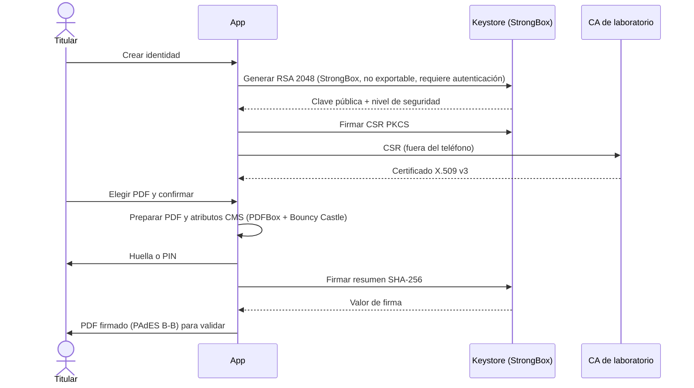

# 📱 Firmador móvil

Aplicación Android (Kotlin) que **genera, protege y usa la clave privada en el propio teléfono** para firmar documentos PDF. La clave nace en Android Keystore con respaldo **StrongBox** y nunca sale del dispositivo.

> ⚠️ **Prueba de concepto académica.** Demuestra viabilidad técnica con un certificado de laboratorio. No es un producto homologado ni equivale a un token ePass2003 de nivel alto.

## 🎯 Qué demuestra

| Pregunta                                  | Evidencia esperada                                                           |
| ----------------------------------------- | ---------------------------------------------------------------------------- |
| ¿La clave se genera en StrongBox?         | `KeyInfo.getSecurityLevel()` = `STRONGBOX` (y atestación, si se obtiene)     |
| ¿La clave queda bajo control del titular? | Clave no exportable; cada firma exige huella o PIN                           |
| ¿El teléfono se integra con una PKI?      | CSR PKCS #10 → certificado X.509 de laboratorio                              |
| ¿El PDF firmado es válido?                | Reportes de Jacobitus y de otros validadores: íntegro y alteración detectada |

## 🧭 Prioridades

- **P1 (núcleo):** firma local en el teléfono, iteraciones I0–I4. Es lo que evalúa la monografía.
- **P2 (complemento):** atención de solicitudes de `firmador-servicio`, iteración I5. Solo si el núcleo está cerrado.

## 🔐 Flujo de firma local

## 🧱 Tecnología

Kotlin · `minSdk 31` (necesario para `getSecurityLevel()`) · Android Keystore/StrongBox · BiometricPrompt · PDFBox-Android + Bouncy Castle (propuesta; ver especificaciones §5).

## 🗺️ Iteraciones

|     | Iteración       | Listo cuando                                                            |
| --- | --------------- | ----------------------------------------------------------------------- |
| I0  | Preparación     | ADB, Android 16 y `strongbox_keystore` registrados                      |
| I1  | Clave protegida | Clave en StrongBox comprobada con `KeyInfo`; uso con autenticación      |
| I2  | Certificado     | CSR verificada fuera del teléfono; el certificado coincide con la clave |
| I3  | Firma PDF       | PDF PAdES B-B generado sin secretos en los registros                    |
| I4  | Validación      | Original íntegro y copia alterada detectada en los validadores          |
| I5  | Complementos    | Integración con el servicio y/o atestación, o "no evaluado"             |

## 🚫 No hace

Certificados reales de AGETIC, sello de tiempo ni LTV, firma automática sin el usuario, homologación ni despliegue en producción.

📄 Detalle: [Especificaciones técnicas](docs/ESPECIFICACIONES_TECNICAS.md)
