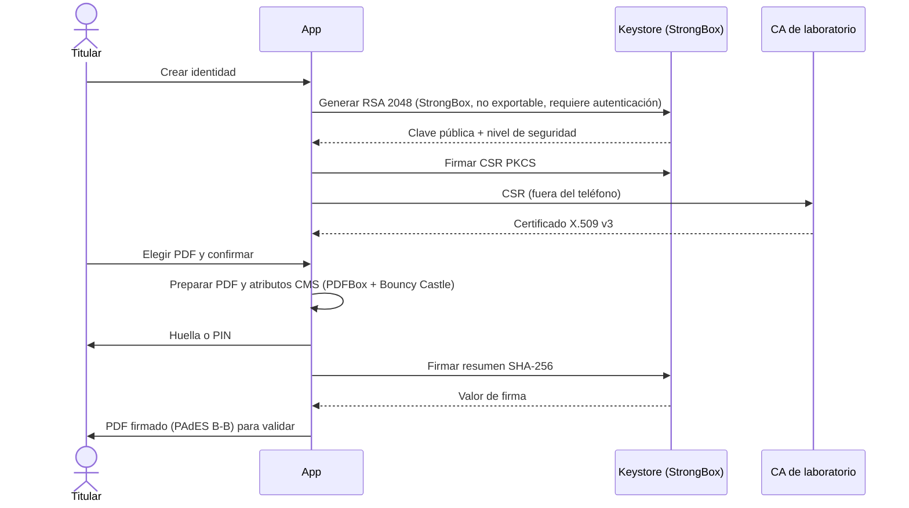

# 📱 Firmador móvil

Aplicación Android (Kotlin) que **genera, protege y usa la clave privada en el propio teléfono** para firmar documentos PDF. La clave nace en Android Keystore con respaldo **StrongBox**, no se puede exportar y cada firma exige la huella o el PIN del titular.

> ⚠️ **Prueba de concepto académica.** Usa un certificado de una autoridad de laboratorio, **sin validez legal**. No es un producto homologado, no equivale a un token de nivel alto y no está preparada para producción.

## 🎓 Contexto

Prueba de concepto de la monografía *Estrategias basadas en PMBOK 7 con un enfoque adaptativo para la incorporación de dispositivos móviles en el servicio de firma digital de la Entidad Certificadora Pública AGETIC, orientadas a la entrega de valor al cliente* (Maestría en Transformación Digital y Gestión de Proyectos Tecnológicos, Universidad Mayor de San Andrés, 2026). El desarrollo se organizó en iteraciones con criterios de aceptación fijados antes de cada prueba; los códigos RF, RT y RS de la documentación remiten a la matriz de requisitos de la monografía.

## ✅ Qué se comprobó

Resultados de la prueba formal (25 de octubre de 2026) en un Samsung Galaxy S23 Ultra con Android 16, con tres validadores: Jacobitus Escritorio, el Validador Web y `pdfsig`.

| Pregunta                                  | Resultado                                                                                          |
| ----------------------------------------- | -------------------------------------------------------------------------------------------------- |
| ¿La clave se genera en StrongBox?         | Sí: `KeyInfo.getSecurityLevel()` = `STRONGBOX` al inicio y al final de la prueba                   |
| ¿La clave queda bajo control del titular? | Sí: no exportable y con autenticación impuesta por el Keystore; una firma sin autenticación falla |
| ¿El teléfono se integra con una PKI?      | Sí: CSR PKCS #10 firmada en el teléfono → certificado X.509 v3 de laboratorio                      |
| ¿Los PDF firmados se validan?             | 60 de 60 casos con el resultado esperado: integridad reconocida y copias alteradas detectadas     |
| ¿Cuánto tarda la firma?                   | Entre 144 y 220 ms (mediana 167,5 ms, n = 10)                                                      |

Con el certificado de laboratorio, los validadores no reconocen la cadena de confianza; esa advertencia se registra aparte y no indica que la firma sea incorrecta. En la iteración I6, la CSR del teléfono tuvo la misma estructura que la de Jacobitus Escritorio (13 de 13 campos) y el certificado imitó el perfil de persona natural de la entidad certificadora (19 de 19 campos).

## 🔐 Flujo de firma local

La app también atiende solicitudes de firma enviadas desde un sistema de gestión documental mediante un enlace: descarga el PDF, muestra la misma confirmación, firma en el teléfono y devuelve el documento al servicio.

## 🧱 Tecnología

Kotlin · `minSdk 31` (necesario para `getSecurityLevel()`) · Android Keystore/StrongBox · BiometricPrompt · PDFBox-Android + Bouncy Castle · Jetpack Compose (ver especificaciones §5).

## 🗺️ Iteraciones

|     | Iteración            | Resultado                                                                         |
| --- | -------------------- | --------------------------------------------------------------------------------- |
| I0  | Preparación          | ADB, Android 16 y `strongbox_keystore` registrados                                |
| I1  | Clave protegida      | Clave en StrongBox comprobada con `KeyInfo`; uso con autenticación                |
| I2  | Certificado          | CSR verificada fuera del teléfono; el certificado coincide con la clave           |
| I3  | Firma PDF            | PDF PAdES B-B generado sin secretos en los registros                              |
| I4  | Validación           | Original íntegro y copia alterada detectada en los tres validadores               |
| I5  | Complementos         | Integración con un sistema documental de ejemplo; atestación no implementada      |
| I6  | Perfil del certificado | CSR con la estructura de Jacobitus y certificado con el perfil de la entidad     |

## 🏷️ Versiones evaluadas

| Prueba                                    | Commit                                                                                                      |
| ----------------------------------------- | ----------------------------------------------------------------------------------------------------------- |
| Prueba formal y prueba de integración (I5) | [`9a77013`](https://github.com/AlexQuispe/firmador-movil/tree/9a77013a6330ccb22e92d51cfd23658effd3ba4f) |
| Iteración I6                              | [`fdd10ac`](https://github.com/AlexQuispe/firmador-movil/tree/fdd10aca4dd2e129d291639f21150e4799ea197f)   |

Los cambios posteriores son de documentación y de mejoras no evaluadas en la monografía.

## ⚖️ Limitaciones

- El nivel StrongBox lo informa Android; no se implementó la atestación del fabricante (FM-12), que permitiría verificarlo fuera del teléfono.
- Versión de desarrollo (`debug`): una computadora conectada por cable puede leer sus datos internos y sus PDF firmados, aunque no la clave.
- Un teléfono, un titular y un certificado de laboratorio: los resultados no se generalizan a otros modelos ni a certificados reales.
- El enlace de solicitudes no verifica criptográficamente la app destino y admite HTTP hacia IP privadas para el laboratorio (especificaciones §6).

## 🚫 No hace

Certificados reales de AGETIC, sello de tiempo ni LTV, firma automática sin el usuario, homologación ni despliegue en producción.

📄 Detalle: [Especificaciones técnicas](docs/ESPECIFICACIONES_TECNICAS.md) · 🛠️ [Manual de instalación](INSTALL.md) · 📜 [Licencia LPG-Bolivia v1.1](LICENSE)
