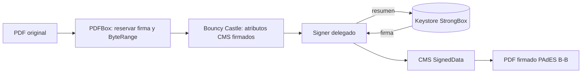

# Especificaciones técnicas — Firmador móvil

**Versión:** 0.2 · **Estado:** listo para implementar · **Trazabilidad:** los códigos RF, RT y RS remiten a la matriz de requisitos de la monografía (apartado 3.2.2).

## 1. Alcance

App Android que firma PDF en el mismo teléfono con una clave generada en Android Keystore con respaldo StrongBox. La clave no se exporta. El certificado lo emite una CA de laboratorio. El flujo con `firmador-servicio` es un complemento (P2).

## 2. Entorno de prueba

- Samsung Galaxy S23 Ultra · Android 16 (API 36) · `feature:android.hardware.strongbox_keystore=4`.
- La característica declarada **no prueba** que una clave concreta esté en StrongBox; eso lo prueba FM-02.
- Linux con Android SDK, JDK y Gradle; las versiones exactas se registran en la evidencia.

## 3. Requisitos

| ID    | Requisito                                                                                                                                            | Prioridad | Verificación                                    | Monografía       |
| ----- | ---------------------------------------------------------------------------------------------------------------------------------------------------- | --------- | ----------------------------------------------- | ---------------- |
| FM-01 | Generar RSA 2048 con `setIsStrongBoxBacked(true)`, propósito SIGN, digest SHA-256                                                                    | P1        | Registro de generación                          | RF01, RT02       |
| FM-02 | Comprobar `KeyInfo.getSecurityLevel() == SECURITY_LEVEL_STRONGBOX`                                                                                   | P1        | Registro de `KeyInfo`                           | RS02             |
| FM-03 | Ante `StrongBoxUnavailableException`, informar y **no** generar en TEE sin avisar                                                                    | P1        | Prueba del manejo de error                      | RS03             |
| FM-04 | Exigir autenticación en cada uso: `setUserAuthenticationParameters(0, BIOMETRIC_STRONG or DEVICE_CREDENTIAL)` + `BiometricPrompt` con `CryptoObject` | P1        | Intento de firma sin autenticación rechazado    | RS04             |
| FM-05 | No exportar la clave privada; solo se lee la pública                                                                                                 | P1        | Revisión de código                              | RS01             |
| FM-06 | Generar una CSR PKCS #10 firmada por la clave del Keystore                                                                                           | P1        | `openssl req -verify`                           | RF02             |
| FM-07 | Guardar el certificado X.509 v3 de laboratorio y comprobar que su clave pública coincide                                                             | P1        | Comparación de claves                           | RF03, RT05       |
| FM-08 | Mostrar nombre y SHA-256 del PDF y pedir confirmación explícita                                                                                      | P1        | Prueba funcional                                | RF04             |
| FM-09 | Firmar PDF como PAdES B-B: `ETSI.CAdES.detached`, SHA-256, `signing-certificate-v2`                                                                  | P1        | Reporte del validador                           | RF04, RT03, RT04 |
| FM-10 | Guardar o compartir el PDF firmado                                                                                                                   | P1        | Archivo transferido                             | RF05             |
| FM-11 | Mostrar titular, emisor y vigencia del certificado                                                                                                   | P2        | Comparación con el certificado                  | RF06             |
| FM-12 | Obtener y exportar la cadena de atestación (`setAttestationChallenge`)                                                                               | P2        | Cadena guardada y verificada fuera del teléfono | RS07             |
| FM-13 | Abrir solicitudes desde enlace, descargar el PDF y devolver el resultado al servicio                                                                 | P2        | Prueba extremo a extremo                        | RF07             |

## 4. Seguridad

- 🔑 La clave privada solo existe en el Keystore; ningún código la lee ni la exporta (RS01).
- 🧾 Nunca registrar PIN, credenciales, tokens ni contenido de PDF en los logs (RS05).
- 👆 La autorización la impone el Keystore (FM-04), no solo la interfaz.
- 🔗 Un enlace solo abre la app y lleva solo el ID: los datos de la solicitud se piden al servicio y el usuario confirma cada firma. La app no lleva credenciales del servicio.
- 📵 Si se pierde o reinstala la app, la clave se pierde: en un escenario real correspondería revocar y emitir un certificado nuevo.

## 5. Arquitectura criptográfica

1. Generar la clave (FM-01 a FM-05) y guardar la atestación de inmediato si se usa FM-12.
2. CSR con `PKCS10CertificationRequestBuilder` y un `ContentSigner` que delega en `java.security.Signature` del Keystore.
3. La CA de laboratorio (OpenSSL en el equipo de desarrollo) emite un X.509 v3 con `keyUsage = digitalSignature, nonRepudiation`.
4. PDFBox prepara el campo de firma con `SubFilter = ETSI.CAdES.detached` y entrega el rango de bytes.
5. Bouncy Castle arma `SignedData` con `signing-certificate-v2`; el valor de firma lo calcula el Keystore tras la autenticación.
6. Se incrusta el CMS y se valida fuera del teléfono.

**Biblioteca propuesta:** PDFBox-Android (Apache 2.0) + Bouncy Castle `bcpkix` (licencia tipo MIT). Ambas permiten un firmante externo. Se descarta iText por su licencia AGPL. Si la delegación falla en I3, se registra como incidencia (riesgo R2).

## 6. Integración (P2)

- Enlace: Intent URI de Chrome `intent://firmar/{id}#Intent;scheme=firmadormovil;package=bo.edu.umsa.firmadormovil;end`, solo con el identificador opaco. La app lo recibe con un `intent-filter` para el esquema `firmadormovil` y el host `firmar`.
- Chrome entrega el intent solo al paquete indicado: ninguna otra app que declare el esquema recibe el ID, y si la app no está instalada no se abre otra. El paquete no se verifica criptográficamente, a diferencia de un App Link con `assetlinks.json`; un APK distinto con el mismo paquete, instalado en lugar de este, lo recibiría. Se declara como limitación.
- Al subir el resultado o registrar el rechazo, mostrar «Firma enviada» (o «Firma rechazada») y cerrar la app para que Android vuelva al navegador. El enlace no devuelve nada a la web: el resultado llega a ella a través del servicio.
- URL del servicio configurable (`SERVICIO_URL` en `local.properties` → `BuildConfig`), por IP o dominio; nunca recibida desde el enlace, para que una web ajena no pueda redirigir los PDF. Con IP y HTTP, permitir tráfico sin cifrar solo para ese host en `network_security_config`; con dominio, HTTPS.
- Contrato de la API: `firmador-servicio/docs/ESPECIFICACIONES_TECNICAS.md`.

## 7. Evidencia por ejecución

Fecha · dispositivo y Android · versión de la app · alias y algoritmo · nivel `KeyInfo` · tipo de certificado · PDF de entrada/salida · validador y versión · resultado esperado y observado. Sin PIN, claves ni datos personales.

## 8. Indicadores

Los define la monografía (apartado 3.2.6) **antes** de las pruebas formales: cumplimiento de requisitos, firmas válidas, compatibilidad con validadores, controles de seguridad verificados y tiempo de firma. Las ejecuciones previas cuentan como iteraciones de desarrollo, no como resultados.

## 9. Riesgos

| Riesgo                                              | Respuesta                                                 |
| --------------------------------------------------- | --------------------------------------------------------- |
| R1 StrongBox no admite el algoritmo                 | Evitar: RSA 2048 + SHA-256                                |
| R2 La biblioteca no permite delegar la firma        | Mitigar: separar armado y firma; probarlo al inicio de I3 |
| R3 Los validadores no reconocen la firma            | Mitigar: PAdES B-B estándar; más de un validador          |
| R4 El certificado de laboratorio no es de confianza | Aceptar: registrar integridad y confianza por separado    |

## 10. Fuera de alcance

Certificados de producción, homologación, TSA/LTV, firma desatendida, emisión institucional y producción.
